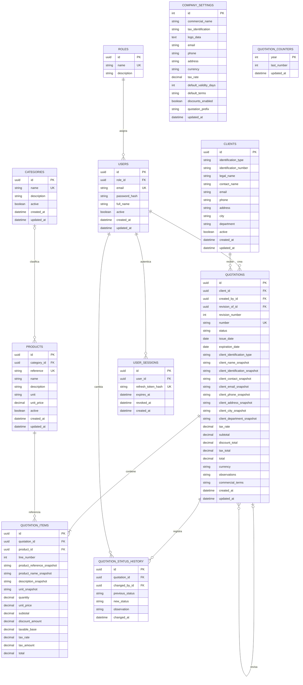

# Modelo entidad-relación

El modelo conserva los datos históricos de las cotizaciones aunque el catálogo o los datos de contacto cambien. La implementación versionada está en [`schema.prisma`](../../backend/prisma/schema.prisma) y su migración inicial en `backend/prisma/migrations/`.

## Entidades y reglas

- **Role / User:** roles únicos `ADMINISTRADOR` y `EMPLEADO`; usuario con correo normalizado único, hash de contraseña, estado activo y rol requerido. El primer administrador se crea por seed controlado, sin registro público.
- **UserSession:** extensión necesaria para revocar sesiones y renovar tokens. Solo almacena el hash del token de renovación, su vencimiento y revocación.
- **Client:** identificación normalizada y única por tipo y número. Desactivación lógica; no se elimina si tiene cotizaciones relacionadas.
- **Category / Product:** referencia/código único; precio no negativo; producto asociado opcionalmente a categoría. Las asociaciones históricas no autorizan usar productos inactivos en cotizaciones nuevas.
- **Quotation:** número único, cliente y usuario obligatorios, valores calculados en backend, estado explícito, tasa e importe capturados, moneda/condiciones y datos del cliente congelados. `revision_of_id` enlaza una nueva cotización con la versión anterior; las originales no se sobrescriben.
- **QuotationItem:** cada línea conserva referencia, nombre, descripción, unidad, precio, cantidad e impuesto aplicados. `product_id` es referencia al catálogo actual, pero no se usa para reconstruir el documento histórico.
- **QuotationStatusHistory:** registro de solo inserción para cada transición, incluyendo estado anterior/nuevo, actor, fecha y observación.
- **CompanySettings:** configuración singleton con valores comerciales y reglas vigentes. El logotipo opcional se almacena como URI de datos PNG validado y se limita por bytes y dimensiones. Cambios futuros no se propagan a cotizaciones ya creadas.
- **QuotationCounter:** contador por año actualizado atómicamente por PostgreSQL para asignar números sin colisiones; los números emitidos no se reutilizan.

## Integridad, tipos y consultas

- Identificadores UUID para entidades transaccionales y claves foráneas con borrado restrictivo donde borrar rompería historia.
- Importes en `Decimal` de precisión fija en Prisma/PostgreSQL; cantidad con escala decimal acotada. No usar `float` para moneda.
- Índices/únicos en correo de usuario, identificación de cliente, referencia de producto, nombre de categoría y número/estado/fechas/cliente/creador de cotización.
- Índices compuestos para listado paginado y filtrado de cotizaciones (estado, fecha y creador) y búsqueda normalizada por cliente.
- `created_at` y `updated_at` en registros editables; historial append-only para cambios de estado.
- La migración agrega `CHECK` de email normalizado, valores requeridos, importes/descuentos/tasas, fechas, vigencia de configuración y contador positivo. La API además exige al menos una línea por cotización.
- Crear una cotización junto a sus detalles e historial inicial dentro de una transacción. Actualizaciones de estado y su historial también son atómicas.
- La migración de base de datos será versionada; no se usará `db push` como sustituto de migraciones en entornos compartidos.
