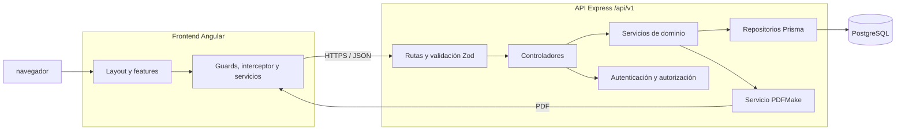
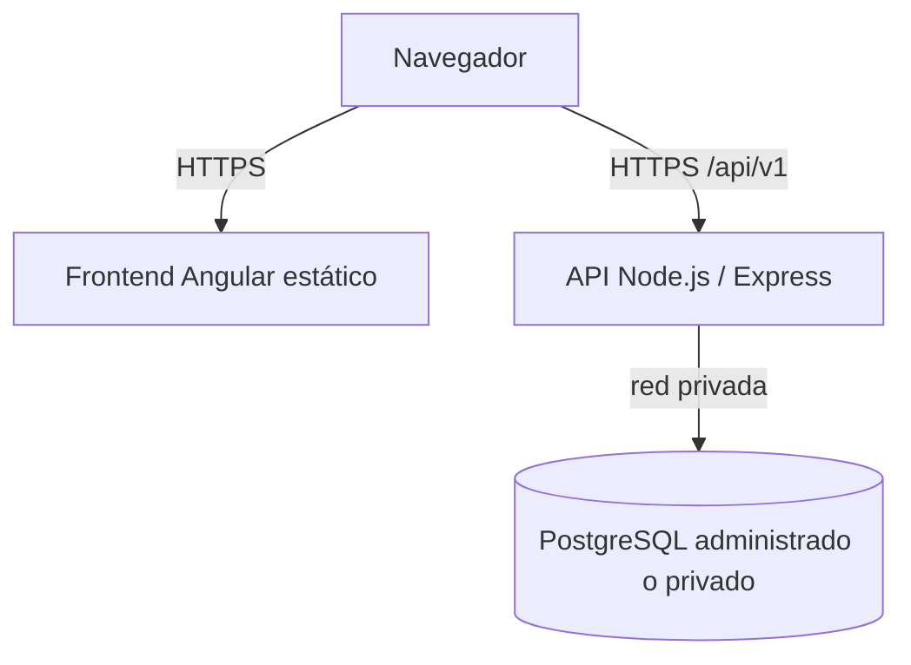
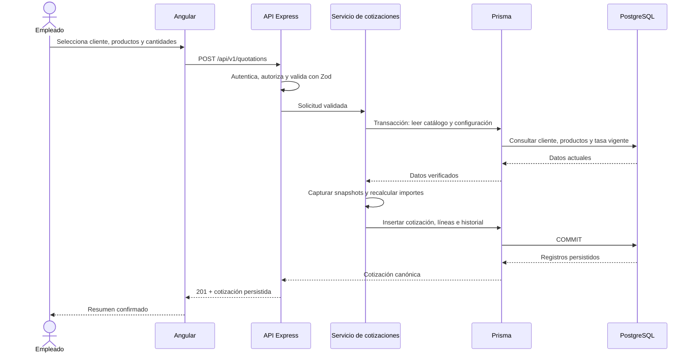

# Arquitectura inicial

## Propósito y alcance

TEKNOPIPE centraliza clientes, catálogo y cotizaciones para reducir tiempos y errores de elaboración y proporcionar trazabilidad. El producto será una aplicación web empresarial con persistencia real, autorización en el servidor, cálculos monetarios reproducibles y generación de PDF desde datos guardados.

El alcance funcional comprende autenticación, usuarios y roles, dashboard, clientes, categorías, productos, cotizaciones, historial, reportes, configuración y PDF. La facturación y el registro de ventas no forman parte del alcance; una cotización aprobada no se contabiliza como una venta.

## Restricciones

- Frontend Angular standalone con Angular Material, TypeScript, SCSS, Router, Reactive Forms, HttpClient y RxJS.
- API REST modular con Express y TypeScript; Prisma y PostgreSQL para persistencia.
- Validación de entrada con Zod; PDF generado con PDFMake.
- Repositorio único, frontend y backend desplegables de forma independiente.
- La interfaz nunca se conecta directamente a PostgreSQL.
- La identidad comercial no suministrada se mantendrá configurable y se documentará como pendiente.

## Componentes

### Responsabilidades

- **Frontend:** presentación, navegación, validaciones de experiencia de usuario, solicitudes HTTP y visualización de errores, cargas y estados vacíos. Los datos y cálculos enviados por el cliente nunca se consideran fuente de verdad.
- **Rutas y controladores:** adaptan HTTP al dominio, validan parámetros y cuerpos, extraen la identidad autenticada y producen respuestas consistentes.
- **Servicios:** aplican permisos, reglas de negocio, transiciones de estado y cálculos; coordinan transacciones para operaciones multi-tabla.
- **Repositorios:** concentran consultas Prisma y evitan acoplar las reglas de dominio a consultas HTTP.
- **PostgreSQL:** fuente de verdad para cuentas, catálogo, configuración, cotizaciones y trazabilidad.

## Despliegue local y destino

En desarrollo, Docker Compose ejecutará PostgreSQL con volumen persistente y comprobación de salud. Angular y Express se ejecutarán como procesos separados, usando variables de entorno locales. En despliegue, frontend, API y PostgreSQL se publican por separado; la base de datos no se expone al navegador ni a Internet. Las credenciales y secretos se suministran por el entorno, nunca por archivos versionados.

## Flujo de creación de cotización

## Seguridad y límites de confianza

Todo endpoint privado verifica el token y el permiso en el backend. Las consultas de empleados se limitan a recursos autorizados; los administradores tienen acceso general. Los secretos se validan al inicio con esquema de entorno. Helmet, CORS con orígenes permitidos, limitación de intentos de login y errores sin detalles internos forman parte de la configuración de API. Ver [decisiones técnicas](./decisiones.md).

## Riesgos iniciales

| Riesgo | Tratamiento |
|---|---|
| Pérdida de exactitud monetaria | Decimal en base de datos y servicio; redondeo explícito y pruebas de límites. |
| Edición del catálogo que cambie el pasado | Snapshots por línea y tasa impositiva capturada al crear la cotización. |
| Cotizaciones vistas o alteradas por usuarios no autorizados | Autorización por rol y propiedad comprobada en cada operación del backend. |
| Colisión de números bajo solicitudes simultáneas | Asignación transaccional/atómica respaldada por restricción única en PostgreSQL. |
| Cambios silenciosos en cotizaciones enviadas | Solo borradores editables; revisiones identificadas y enlazadas al original. |
| Datos comerciales desconocidos | Configuración provisional sin inventar dirección, NIT ni contacto; completar antes del despliegue. |
| Exposición de credenciales | `.env` ignorado, `.env.example` sin secretos y configuración validada al arrancar. |
